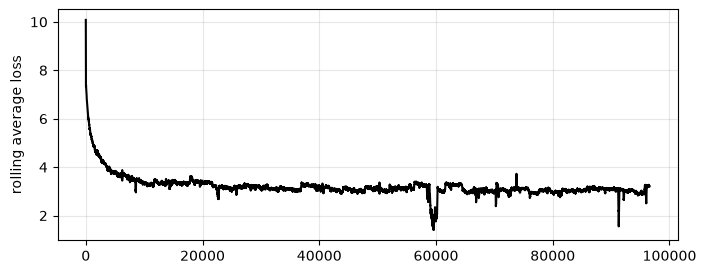
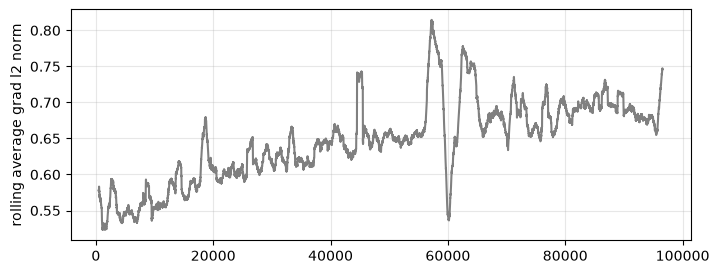
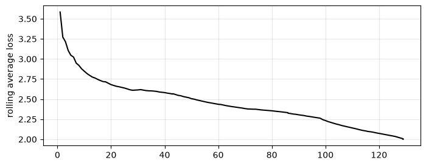
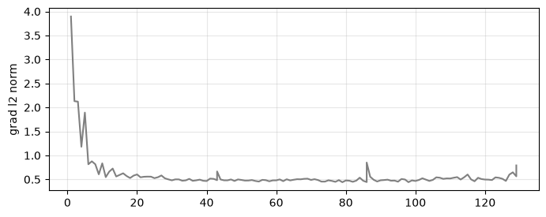
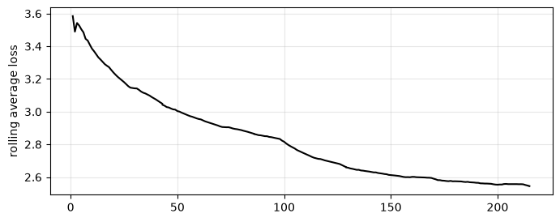
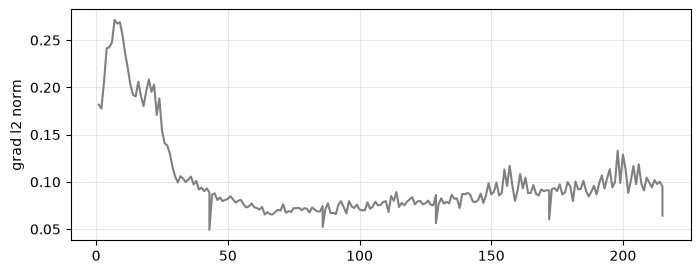

# askwiki

> A ~116M parameter GPT-2-style model pre-trained from scratch on English Wikipedia (test loss 3.07), then fine-tuned on 25k synthetic Q&A pairs with full-model SFT and with LoRA (r=8, ~0.4% of parameters trained).

I built askwiki to work through the whole language-model pipeline myself on one consumer GPU with 8GB of VRAM: cleaning the data, training a tokeniser, writing the model, pre-training, generating synthetic SFT data, and fine-tuning, both full-model and with LoRA adapters. The result is a decoder-only transformer that answers short questions in the right format, and usually with the wrong facts.

The trained weights, tokeniser and datasets are on Hugging Face: **[notoverfit/askwiki](https://huggingface.co/notoverfit/askwiki)**.

---

## Repository layout

```
src/askwiki/
├── data/            # text cleaning, tokeniser training, binary token dataset
├── model/           # attention, transformer block, LoRA adapter, full net
├── training/        # config-driven training loop with checkpointing and optional LoRA (see training/README.txt)
├── inference/       # sampling helpers: chat (base model) and chat_v2 (SFT format)
└── research/
    ├── pre_training/notebooks/
    │   ├── 01_model_and_training_decisions.ipynb
    │   └── 02_pre_training_results.ipynb
    └── post_training/notebooks/
        ├── 01_generating_q_and_a_responses.ipynb
        ├── 02_post_training_results.ipynb
        └── 03_post_training_lora.ipynb
outputs/             # figures referenced below
references/          # papers cited in the notebooks
```

---

## 1. Data and tokeniser

The corpus is an English Wikipedia dump, distributed as parquet shards. Raw articles are noisy: stripped pronunciation guides leave empty parentheses (`Albedo (; ) is ...`), and articles end in *See also* / *References* / *External links* sections, with template and HTML fragments and odd Unicode whitespace scattered throughout. `src/askwiki/data/utils/clean.py` removes these with a set of regex passes before tokenisation.

I trained a BPE tokeniser with a **20,000-token vocabulary** on a hash-based 20% sample of the training split and pushed it to the Hugging Face repo under `tokenizer/`. Each split is then tokenised and written to a flat `uint16` `.bin` file. The `TokenSequence` dataset reads that file in fixed-length windows, so the data loader never holds the corpus in memory.

## 2. Model and training decisions

*Notebook: [`pre_training/01_model_and_training_decisions.ipynb`](src/askwiki/research/pre_training/notebooks/01_model_and_training_decisions.ipynb)*

I took most architectural choices from GPT-2 small rather than spend compute on a hyperparameter search:

| | |
|---|---|
| Embedding dim | 768 |
| Blocks | 12 |
| Heads | 12 (head dim 64) |
| MLP dim | 3072 (4×) |
| Context length | 512 |
| Positional encoding | learned, absolute |
| Norm placement | pre-norm |
| Parameters | ~116M (≈85M in blocks, the rest in untied input/output embeddings) |

I didn't tune the number of heads, since Michel et al. (2019) found that many heads can be pruned at test time with little loss in quality; I used the standard 64-dim head. Each block adds about $12d^2 \approx 7.1\text{M}$ parameters ($4d^2$ for attention, $8d^2$ for the MLP), so 12 blocks put the model near my ~100M target.

The main open question was how large a batch fits in 8GB. I profiled one forward and backward pass under bf16 autocast:

| Batch | Time | Peak VRAM |
|---:|---:|---:|
| 2 | 46 ms | 1.74 GB |
| 4 | 88 ms | 2.78 GB |
| 8 | 202 ms | 4.87 GB |
| 16 | 1,661 ms | 9.05 GB |
| 32 | 16,046 ms | 17.39 GB |

Going from 4 to 8 roughly doubles the time, as expected. Going from 8 to 16 multiplies it by ~8, because peak memory (9.05 GB) exceeds the card and spills into system memory. I settled on a micro-batch of 8 with 8 gradient accumulation steps, for an effective batch of 64 sequences (~32k tokens). The optimiser is AdamW with lr 3e-4, betas (0.9, 0.95) and weight decay 0.01 (`training/configs/base.yaml`).

## 3. Pre-training results

*Notebook: [`pre_training/02_pre_training_results.ipynb`](src/askwiki/research/pre_training/notebooks/02_pre_training_results.ipynb)*

Pre-training ran for about three days (~96k steps). I stopped it once the loss stopped improving.





Loss falls from ~10 to ~3.5 in the first 10k steps, then flattens slowly to just above 3. The rolling gradient norm drifts up from ~0.55 to ~0.7 over the run.

Around step 60k the loss briefly drops below 2, while the gradient norm spikes and then collapses. Decoding the training data at that position (step × 64 sequences) shows a long run of templated articles about small U.S. towns and townships, each with the same census, area and demographics paragraphs. The model fits that template almost perfectly until the run ends. The articles were tokenised in their original order, so similar articles sit next to each other in the token file; shuffling articles before tokenising would have spread them out.

| | Loss |
|---|---:|
| Train (mean of last 1,000 steps) | 3.10 |
| Test | **3.07** |

Train and test loss are almost equal, so the model is not overfitting; at this size it is more likely limited by capacity. Samples are grammatical and read like Wikipedia: declarative, encyclopaedic, full of dates and proper nouns. They drift off-topic within a sentence or two and mix up facts, and at lower temperatures the model tends to repeat a phrase indefinitely.

## 4. Generating SFT data

*Notebook: [`post_training/01_generating_q_and_a_responses.ipynb`](src/askwiki/research/post_training/notebooks/01_generating_q_and_a_responses.ipynb)*

The base model can only continue text. To make it answer questions, I generated a synthetic Q&A set with a larger model:

- I sampled **25,000 articles** from the training split, truncated each to ~6,000 characters at a sentence or paragraph boundary, and asked **Qwen3.5 4B** (via Ollama, thinking disabled for throughput) to write one question-and-answer pair grounded in the passage.
- Ollama's structured outputs constrained each response to a Pydantic schema (`{user, assistant}`), so every successful call parses.
- Each pair is formatted as `user: <question> assistant: <answer><eos>` and tokenised into `sft_tr.bin`.

I left the source passage out of the training text on purpose. With the passage in context, the model would learn to answer from it, as in RAG. Without it, the model learns the format of an answer and has to draw the content from what it learned in pre-training.

## 5. Post-training results

*Notebook: [`post_training/02_post_training_results.ipynb`](src/askwiki/research/post_training/notebooks/02_post_training_results.ipynb)*

I fine-tuned the full model from the pre-trained checkpoint for 3 epochs on the SFT set (43 optimiser steps per epoch), with the same optimiser settings as pre-training (`training/configs/sft.yaml`). This stage had no held-out validation split.





Loss goes from ~3.6 to ~2.0 and is still falling at the end. It drops in visible steps at the epoch boundaries (~43 and ~86), which, given how small the dataset is, I read as the model starting to memorise the SFT set by epoch 3. Gradient norms settle quickly at ~0.5, with small bumps at each new epoch.

On prompts the model never saw, the base model gets the same `user: ... assistant:` prefix, a format it has never been trained on. I sampled it at T=1.0 because it falls into repetition loops at lower temperatures; the SFT model is at T=0.5.

| Prompt | Pre-trained model | SFT model |
|---|---|---|
| What is the capital of France? | *René Corot, not a minister. In 1998 in Legio XII, he shouted to his press…* | Paris. |
| Who was Isaac Newton? | *Anosyntaph. Toddrai Watts: Sext fighting: Dartfield thanAR…* | Isaac Newton (also spelled Isaac Newton) was an English priest who was born in 1653. |
| What is the largest ocean on Earth? | *So it is when we change things. Keyboards Medical Navck Scientists use…* | The largest ocean on Earth is the North Atlantic Ocean. |
| Which country is the Great Wall located in? | *Love a soul. The journey, sat near, is unmistakably composed of…* | Great Wall is located in the Czech Republic. |
| Who painted the Mona Lisa? | *ANCY! "PDistribution Return Painting" by Krenew…* | The painting was created by artist Mary Beth Williams. |
| Where is Mount Everest? | *Res1989. Caintance of the Person.Withnote: George VI…* | Mount Everest is a mountain in southern California, United States… |

About 130 optimiser steps took the model from free association to short, direct answers that stop at EOS. Apart from "Paris", though, every answer is wrong, and stated with the same confidence. Several land near the truth ("English", "ocean", the 1650s for Newton, who was born in 1643), consistent with a model that has learned topical associations but not reliable facts.

## 6. Post-training with LoRA

*Notebook: [`post_training/03_post_training_lora.ipynb`](src/askwiki/research/post_training/notebooks/03_post_training_lora.ipynb)*

Full fine-tuning updates all ~116M parameters to teach what is mostly a change of format. To see how few parameters that needs, I repeated the SFT run with LoRA (Hu et al., 2021): the pre-trained weights $W_0$ are frozen and each targeted layer learns a low-rank update instead,

$$W = W_0 + \frac{\alpha}{r} BA, \qquad A \in \mathbb{R}^{r \times d_\text{in}},\; B \in \mathbb{R}^{d_\text{out} \times r}.$$

`LoRALinear` (`src/askwiki/model/modules/lora.py`) wraps an existing `nn.Linear`. $B$ is initialised to zero, so training starts exactly at the pre-trained model, and $A$ is drawn uniformly from $\pm 1/\sqrt{d_\text{in}}$. When a config sets `lora_r`, `lora_alpha` and `lora_targets`, the training loop freezes the network, replaces the named layers with `LoRALinear`, and passes only the adapter parameters to the optimiser (`training/configs/lora.yaml`).

I used $r = 8$, $\alpha = 16$ and adapted both linear layers in each attention block: the fused QKV projection (`attn_proj`, $d \to 3d$) and the output projection (`out_proj`, $d \to d$). That gives $r(d + 3d) + r(d + d) = 48d \approx 37\text{k}$ trainable parameters per block, against $4d^2 \approx 2.4\text{M}$ for the same weights under full fine-tuning: **~0.44M in total, ~0.4% of the model**. The MLPs and embeddings are frozen. I trained for 5 epochs (215 optimiser steps) at lr 5e-4, with the other settings as in the full SFT run.





Loss falls from ~3.6 to ~2.55 and is flattening by the end. There are no clear drops at the epoch boundaries, and it finishes well above the ~2.0 the full run reached in fewer epochs. Either LoRA underfits the SFT set or the full run overfit it, which would be consistent with its confident wrong answers. Gradient norms peak around 0.27 early on, then settle at 0.07–0.1, far below the clipping threshold of 1.

The same prompts, with both models at T=0.5:

| Prompt | Full SFT | LoRA (r=8) |
|---|---|---|
| What is the capital of France? | Paris. | The capital of France is the capital of the department of Rennes. |
| Who was Isaac Newton? | Isaac Newton (also spelled Isaac Newton) was an English priest who was born in 1653. | Isaac Newton (1738–1807) was a British politician who served as the Member of Parliament (MP) for the constituency of East Sussex. |
| What is the largest ocean on Earth? | The largest ocean on Earth is the North Atlantic Ocean. | The largest ocean on Earth is the Moon. |
| Which country is the Great Wall located in? | Great Wall is located in the Czech Republic. | The Great Wall is located in the Meuse Valley of France. |
| Who painted the Mona Lisa? | The painting was created by artist Mary Beth Williams. | The painting was painted by the Italian painter Luigi Parente. |
| Where is Mount Everest? | Mount Everest is a mountain in southern California, United States… | Mount Everest is a mountain located in the southern part of the Alps. |

The LoRA model is as confidently wrong as the full SFT model, loses "Paris", and produces more tautologies ("The first person to walk on the Moon was the first person to walk on the Moon."). Its answers have the same form, though: short, restating the question, and ending at EOS. $r=8$ updates to the attention layers were enough to learn the answer format, which supports the reading of section 5 that SFT here mostly teaches how to answer rather than what to say. The adapters are also small and detachable, so one frozen base model could serve several of them.

## Reproducing

```bash
uv sync
# set DATAPATH, CHECKPOINTPATH and CONFIGPATH in .env
uv run python -m askwiki.training.train
```

`CONFIGPATH` points to the config directory; the config file itself (`base.yaml` for pre-training, `sft.yaml` for full fine-tuning, `lora.yaml` for LoRA) is set by `config_path` in `train.py`. The SFT and LoRA configs load the pre-trained weights from `base_model`. See `src/askwiki/training/README.txt` for the config format.

To skip training and go straight to the results notebooks, download the pre-built token files, SFT data and checkpoints from [notoverfit/askwiki](https://huggingface.co/notoverfit/askwiki).

## References

- Vaswani et al. (2017). *Attention Is All You Need.*
- Michel, Levy & Neubig (2019). *Are Sixteen Heads Really Better than One?*
- Radford et al. (2019). *Language Models are Unsupervised Multitask Learners* (GPT-2).
- Hu et al. (2021). *LoRA: Low-Rank Adaptation of Large Language Models.*
- Hoffmann et al. (2022). *Training Compute-Optimal Large Language Models* (Chinchilla).
